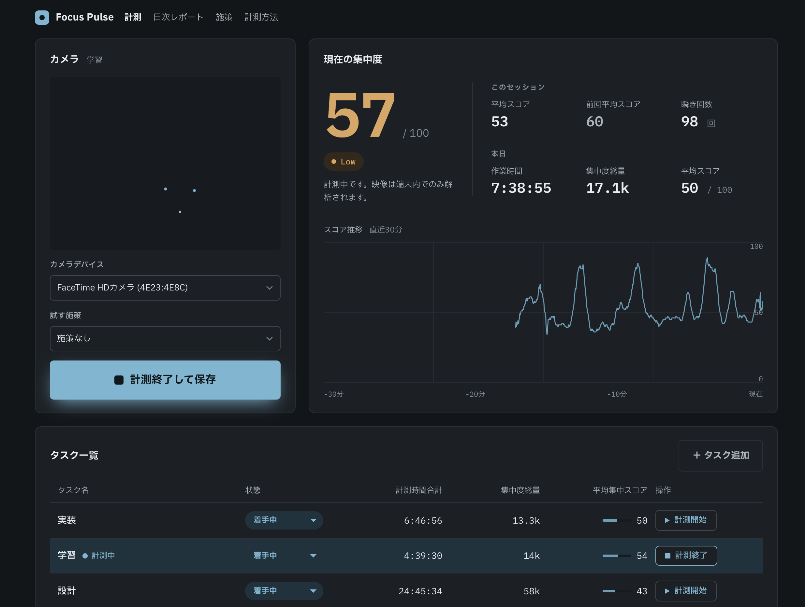

# Matatakuma

タスクごとの集中力をWebカメラで計測し、日次で振り返るローカル専用アプリ。映像解析はすべてブラウザ内（MediaPipe）で完結し、映像・画像・ランドマーク座標はサーバに送信・保存しません。



## 特徴

- **プライバシーファースト** — カメラ映像の解析は端末内で完結。サーバへ送るのは集計済み数値のみ。
- **ローカル専用** — サーバは `127.0.0.1` のみにバインドし、外部からアクセスできない。
- **リアルタイム集中スコア** — 視線・頭の安定・瞬き・継続性・顔検出から 0〜100 のスコアを算出し、直近30分の推移を可視化。
- **タスク別集計** — タスクごとに計測時間・集中度総量・平均スコアを記録。
- **日次レポートと施策（PDCA）** — 当日の集中度を振り返り、施策メモを記録。施策あり/なしで効果を比較。

## 集中スコアの算出

```text
score = 100 * (0.35 * GazeOnScreen + 0.25 * HeadStable + 0.15 * BlinkNormal
              + 0.15 * SessionContinuity + 0.10 * FacePresent)
```

状態のしきい値: 顔検出率 < 50% で「離席」、スコア >= 90 かつ顔検出率 >= 85% で「High」、スコア >= 65 で「Medium」、それ以外は「Low」。

## プライバシー設計

- 映像解析（MediaPipe）はすべてブラウザ内で完結し、映像・画像・ランドマーク座標はサーバに送信・保存しない。
- サーバへ送るのは集計済み数値（平均スコア・状態別割合・中断回数・計測秒数）のみ。
- サーバは `127.0.0.1` のみにバインドし、外部からアクセスできない。

## 動作環境

- Ruby / Rails 8（Haml ビュー、Stimulus、importmap、SQLite）
- Webカメラと、MediaPipe が動作するモダンブラウザ

## 起動

```bash
bin/rails db:migrate
bin/rails server
```

ブラウザで `http://127.0.0.1:8765` を開く。
`3000` や `8000` は他の開発サーバーと衝突しやすいため、このアプリの既定ポートは `8765` にしている。

計測方法・根拠・限界・プライバシーの説明は `http://127.0.0.1:8765/about` にまとめている。

## 使い方

1. タスク一覧でタスクを追加する。
2. 「計測開始」で計測画面へ移動し、カメラ許可後に計測を開始する。
3. 作業終了時に「計測終了して保存」を押すと、セッションの集計値だけが保存される。
4. 「日次レポート」で当日の集中度を振り返り、施策メモ（PDCA）を記録する。

計測中はウィンドウを狭めるとミニモードに切り替わり、別タブに移動しても解析を継続する。

## テスト

```bash
bin/rails test

node app/javascript/focus/aggregate.test.mjs
node app/javascript/focus/landmarks.test.mjs
node app/javascript/focus/score.test.mjs
node app/javascript/controllers/measure_controller.test.mjs
node app/javascript/controllers/report_chart_controller.test.mjs
```
